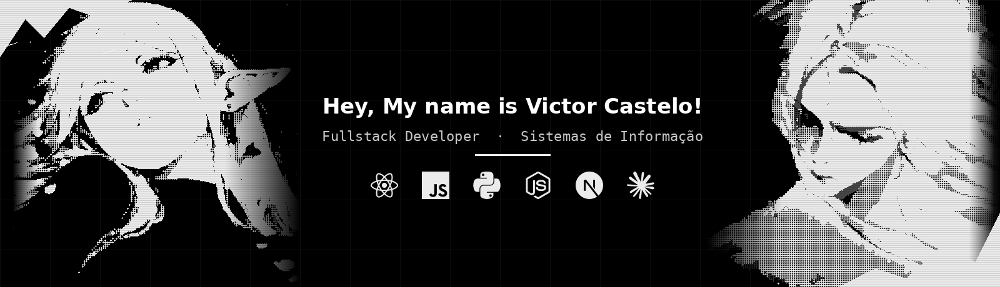

  

## >_ Olá!

Que bom que você passou por aqui. 👋

Sou **Victor Castelo**, desenvolvedor Fullstack de 22 anos, de Barra dos Coqueiros - SE. Gosto de construir coisas para a web, do front ao back, e de usar IA no meu fluxo de trabalho.

## >_ Sobre mim

- **Fullstack Developer** na **Agroboard**
- **Graduação em Sistemas de Informação** *(em andamento)*
- 📍 Barra dos Coqueiros, Sergipe, Brasil
- 🌐 Português fluente · Inglês intermediário

## >_ Tecnologias

## >_ Contato

- 💼 LinkedIn: _adicione seu link_
- 📸 Instagram: _adicione seu link_
